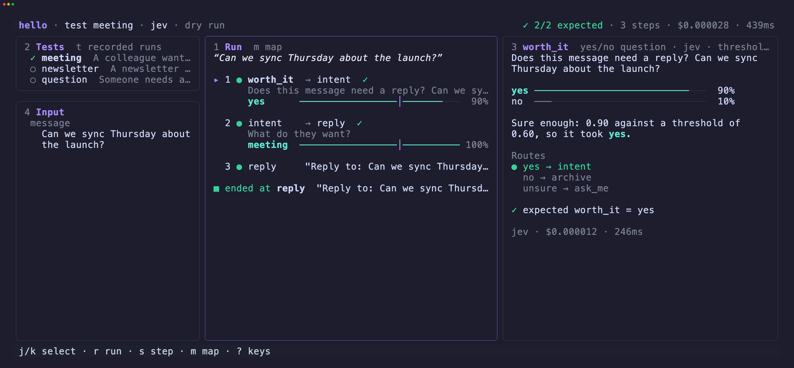

# hunch

Decision flows in YAML. You write the questions a model should answer
(yes/no, pick one, score 1–5), say where each answer leads, and hunch runs
it: it asks, branches on the answer **and on how sure the model is**, and
does the work at the end (call an API, run a command, write a reply).



## Install

```sh
go install github.com/Andree37/hunch/cmd/hunch@latest
```

Then say which models you use in a `hunch.yaml` in your project folder
(copy [`hunch.example.yaml`](hunch.example.yaml); see
[Models](#4-pick-your-models)). The examples ask Jev, so the smallest one is:

```yaml
models:
  jev: {url: https://api.typesafe.ai/v1/systemone, key: tsk-...}
```

`--model mock` runs a flow offline, but mock makes its answers up, so tests
fail on it.

## How it works

- A **flow** is a YAML file of named **nodes**. It starts at the first one.
- **Decision nodes** ask the model a typed question. The answer picks the
  next node through `then:`.
- Every answer comes with a **confidence**. Below the flow's `threshold`
  (0.6 unless set), the `unsure` branch wins, so a person can look at it.
- **Action nodes** do things: say something, run a command, call an API,
  write text with a model, or set the flow's output.
- Every node's result is kept, so later nodes can use it:
  `{{intent.answer}}`. A name that isn't a node is an input: `{{message}}`.

## Walkthrough

### 1. Write a flow

[`examples/hello.yaml`](examples/hello.yaml) decides whether a message needs
a reply, and what kind:

```yaml
name: hello

nodes:
  worth_it:
    bool: "Does this message need a reply? {{message}}"
    then: {yes: intent, no: archive, unsure: ask_me}   # unsure = low confidence

  intent:
    choice: "What do they want?"
    options: [meeting, info, sales]
    then: {sales: archive, _: reply}                   # _ = anything else

  reply:   {action: log, message: "Reply to: {{message}}"}
  archive: {action: log, message: Archived.}
  ask_me:  {action: log, message: "Not sure, you decide."}
```

Every command checks a flow before running it and stops on mistakes:
branches that go nowhere, answers with no branch, nodes nothing reaches,
refs to nodes that haven't run yet. The TUI shows them at the top.

### 2. Run it

```sh
hunch run examples/hello.yaml --set message="Can we sync Thursday?"
```

Inputs come from `--set name=value`, or from a test case with `--case NAME`.
`--json` prints everything the run produced, for scripts.

### 3. Write test cases

A test case is an input plus the answers you expect. Cases live next to the
flow: `hello.yaml` → `hello.tests/*.yaml`.

```yaml
# examples/hello.tests/meeting.yaml
description: A colleague wants to meet
input:
  message: Can we sync Thursday about the launch?
expect:
  worth_it: yes
  intent: meeting
```

```sh
hunch test examples/hello.yaml
```

Run them after changing a question, or with another `--model`, to see what
got better or worse.

### 4. Pick your models

Flows don't name their models; `hunch.yaml`, in the project folder (or any
folder above the flow), lists them once for every flow:

```yaml
default: jev       # decides, unless --model or b in the TUI says otherwise
writer: claude     # writes text for llm nodes

models:
  jev:    {url: https://api.typesafe.ai/v1/systemone, key: tsk-...}
  laya:   http://localhost:8000/v1/systemone
  claude: {url: https://api.anthropic.com/v1/messages, key: sk-ant-..., model: claude-opus-5-5}
  llama:  {url: http://localhost:11434/v1/chat/completions, model: llama3.2}
```

A model is the URL of its endpoint, plus a `key` and a `model` name where
the server wants them. The URL's path says how to talk to it:

| Endpoint | Speaks | For example |
|---|---|---|
| `.../v1/systemone`, `.../decisions` | decision models, with calibrated confidence | Jev (TypeSafe, OpenRouter, Runware), Laya (`laya-serve` on your machine or a server) |
| `.../chat/completions` | OpenAI-style chat | OpenAI, Ollama, OpenRouter, Groq, vLLM, Azure OpenAI |
| `.../v1/messages` | Anthropic | Claude |
| `https://bedrock-runtime.REGION.amazonaws.com` | Amazon Bedrock | your AWS login, no key |

`mock` is always there. `hunch.yaml` holds keys, so keep it out of git, or
write `key: $SOME_VAR` to read one from the environment. Chat models report
their own confidence, so check thresholds that depend on it against your
tests.

### 5. Explore it in the TUI

```sh
hunch tui                                      # pick a flow in this folder
hunch tui examples/hello.yaml    # or open one
```

Load a test case (or type an input), press `r`, and see the path the run
took, each question as it was asked, and how sure the model was of every
answer, as in the screenshot at the top. The keys are listed at the bottom of
the screen.

Press `R` to run every test at once and see them side by side: one row per
test, one column per question, each answer with ✓ or ✗. Leave it up while you
edit the flow or a test in your editor: every save runs them all again and
marks what changed (`✗→✓`, `was 9/12`). `enter` on a row opens that test's run.
`←`/`→` pick a question, and `[` and `]` try a lower or higher threshold
for it on the answers already there, with no model calls, so you can see
which tests it would send to `unsure`. `w` writes the thresholds you settled
on into the flow. `A` asks the model only for tests that now reach a new
question.

### 6. Make it do things

Actions are nodes too. Their result is kept like any answer:

```yaml
draft:
  action: llm                  # a model writes text
  prompt: "Write a short reply to: {{message}}"
  then: check
check:
  bool: "Is this safe to send without a person? {{draft.text}}"
  then: {yes: send, no: hold, unsure: hold}
send:
  action: http
  url: "{{post_url}}"
  headers: {Authorization: "Bearer $API_TOKEN"}   # $VARS come from the environment
  body: {reply: "{{draft.text}}"}
  then: sent
sent: {action: output, set: {action: sent}}
hold: {action: output, set: {action: needs_human, reply: "{{draft.text}}"}}
```

| Action | Does | Result |
|---|---|---|
| `log` | says a message | `message` |
| `shell` | runs a command | `stdout`, `exit_code` |
| `llm` | writes text with the writer model | `text` |
| `http` | calls an API, with retries | `status`, `body` |
| `output` | sets the flow's outputs | the values |

`hunch test` and the TUI don't run shell commands or send http writes (POST,
PUT, PATCH, DELETE); they show what would have been done. `--live` (or `L` in
the TUI) does it for real. `hunch run` does it unless given `--dry-run`.

### 7. Turn real runs into tests

Every run (from `hunch run` or the TUI) is recorded next to the flow, in
`hello.runs/`. Open the flow in the TUI and press `2` to see them (`t`
switches between runs and tests), `enter` to replay one, `c` on two of them
to compare them side by side, and `n` to save one as a test case. That's how real inputs turn into tests.

## Node types

| Node | Asks | `then:` keys | Result |
|---|---|---|---|
| `bool` | yes or no | `yes`, `no`, `unsure` | `answer`, `p`, `confidence` |
| `choice` | one of `options` | each option, `_`, `unsure` | `answer`, `probs`, `confidence` |
| `score` | a level on `scale: 1-5` | `">=4"`, `"<4"`, `"2-4"`, `_` | `answer`, `level`, `confidence` |
| `questions` | several of the above in one call | one next node | one result per question |
| `switch` | nothing: routes on a value with plain code | each value, `_` | |

## Commands

| Command | Does |
|---|---|
| `hunch tui [FLOW]` | build and explore it: run tests, see why, try thresholds |
| `hunch test FLOW` | run its test cases |
| `hunch run FLOW` | run it once, on real input |

## Examples

| Flow | What it does |
|---|---|
| [`hello.yaml`](examples/hello.yaml) | The flow above. |
| [`inbox.yaml`](examples/inbox.yaml) | Triage a message, with scores and several questions at once. |
| [`respond.yaml`](examples/respond.yaml) | Draft a reply, check it, then send it or hand it to a person. |
| [`triage.yaml`](examples/triage.yaml) | Route and re-grade support tickets fetched from a ticket API. |

## More

Everything else (inputs and their types, what a model sees, refs, retries,
where runs are recorded) is in
**[docs/reference.md](docs/reference.md)**.

The screenshot is taken with [VHS](https://github.com/charmbracelet/vhs):
`docs/demo/screenshot.sh`.
